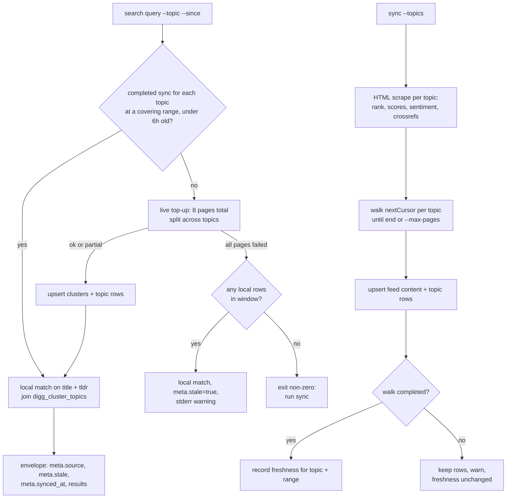

# Digg CLI Endpoint Repair - Plan

Target CLI: `library/media-and-entertainment/digg` (all unit file paths below are relative to the repo root).

---

## Goal Capsule

- Objective: A user or agent running `digg-pp-cli search` gets current Digg stories for any Digg section, and every other command either works against the live site or says plainly that its data source is gone. No command quietly returns stale or empty data as if it were fresh.
- Means: Rebuild search and sync on Digg's live feed API `/api/feed/continuous` (KTD1, KTD2), and retire the pipeline-status surfaces Digg removed (KTD5).
- Authority: Product Contract requirements win on behavior. KTDs win on mechanism. Units override neither.
- Stop conditions: Stop and report if `/api/feed/continuous` starts rejecting non-browser requests (403, challenge page), or if its response shape differs from the Appendix sample. Either one means the API has moved again and this plan's core assumption is gone.
- Execution profile: Hand fix to an already-published CLI, shipped as one PR to `mvanhorn/printing-press-library` from branch `fix/digg-endpoints`, with one new `.printing-press-patches/<id>.json` record (KTD7).
- Finishing: The implementer runs the Verification Contract and opens the PR. The last30days consumer change is separate work (see Scope Boundaries).

---

## Product Contract

### Summary

Digg removed its story-search endpoint and its pipeline-status endpoint, and moved several pages from `/ai/*` to `/tech/*`. This plan moves `search` and `sync` onto the paginated feed API Digg's own site now uses, adds every Digg section as a topic, retires the commands whose data source no longer exists, and makes failures loud instead of silently stale.

### Problem Frame

last30days has returned zero Digg items on every run since about 2026-10-06. Live checks on 2026-10-21 show this is not a bot block: pages and APIs answer any user agent with 200s, and the failing endpoints return 404 or 410 regardless of headers.

- `GET /api/search/stories` returns 404 and `GET /search` returns 410 Gone. Story search has been removed from Digg.
- `GET /api/trending/status` returns 404. `sync` fetches it after committing clusters and aborts, so every sync exits non-zero and nobody trusts the store. The user's local store was last refreshed on 2026-06-15.
- `search` in its default auto mode catches the 404, prints one stderr line, and answers from the stale local store with exit 0. last30days then filters those June items out against its 30-day window and reports "0 items (no results)". That is why the failure went unnoticed for two weeks.
- `/ai/1000`, `/ai/github/*`, and `/ai/x/rankings/companies` now 308-redirect to `/tech/...`. `rankings emerging` and `rankings movers` fail with `section wrapper not found in RSC stream`. GitHub feeds and `authors list` still work because the redirect is followed and the payload still parses.
- Digg now has eight sections (`ai`, `tech`, `world-business`, `sports`, `science`, `gaming`, `entertainment`, plus `all`). The CLI's `sync --topics` list (`technology`, `world`, `politics`, `business`, `news`) no longer matches any of them except `ai`, `science`, `sports` and `entertainment`.

### Requirements

Search
- R1. `search <query>` returns stories from Digg's current feed whose title or summary matches the query, filtered by `--since`, for one or more Digg sections chosen with `--topic`.
- R2. Each search result keeps the existing JSON field names and fills `clusterId`, `clusterUrlId`, `title`, `tldr`, `rank`, `postCount`, `uniqueAuthors`, and `firstPostAge` (an `Nh`/`Nd`/`Nw`/`Nm` token), so last30days' `lib/digg.py` keeps working unchanged.
- R3. `search` completes within 30 seconds on the last30days call shape (`search <topic> --since 30d --agent --limit N`) when the local feed copy is fresh.
- R4. `search` never presents stale data as current. When it answers from data older than the requested window allows, or cannot reach Digg, the JSON `meta` says so and stderr warns. When it has no usable data at all, it exits non-zero with a hint to run `sync`.

Sync and topics
- R5. `sync` refreshes the local store from the feed API for every requested topic and exits 0 when the feed fetch succeeds, even though pipeline events are no longer available.
- R6. `--topic` (search) and `--topics` (sync) accept exactly Digg's current sections: `ai`, `tech`, `world-business`, `sports`, `science`, `gaming`, `entertainment`, `all`. Unknown values are a usage error listing the valid ones.
- R7. A single failed page or topic during a multi-page fetch warns on stderr and keeps the results already fetched. A fetch that decodes to zero stories on its first page is an error, not an empty success.

Moved and removed surfaces
- R8. Commands that read moved pages (`github *`, `authors list/get`, `rankings *`, `watch`, `open`, post fetches) use the current URLs directly instead of relying on redirects.
- R9. `rankings emerging` and `rankings movers` work against the current rankings page, or fail closed with a message that names the removed view if Digg no longer publishes it.
- R10. `pipeline status`, `trending`, and the MCP `trending_status` tool are removed. `events` stays as a read of already-stored events and its help says no new events will arrive.

Docs
- R11. README, SKILL.md, `which` capability index, root help, agent context, and MCP descriptions describe the new behavior and no longer mention removed endpoints or commands.

### Key Decisions

- Cover every Digg section, not only AI and tech. The CLI is a general Digg client, and last30days picks its own topics. Governs R1, R6.
- Remove the pipeline-status commands instead of faking them. No replacement endpoint exists in Digg's current site bundles. Governs R10.

### Success Criteria

- `digg-pp-cli search claude --since 30d --agent --limit 10` after a fresh `sync --topics ai,tech` returns at least one result with a non-empty `title` and a `firstPostAge` within 30 days, in under 30 seconds.
- A last30days run on an AI topic shows a non-zero Digg line again (checked manually after release, outside this PR).

### Scope Boundaries

- Not building server-side search. Digg rejects unknown query parameters on the feed API with `{"error":"Invalid query parameters"}`, so matching is local by necessity.
- Not reconstructing pipeline events from other data. Considered and not built: deriving "fast climb" events from rank deltas between syncs. It would be a new feature with new semantics, and nothing currently depends on it. Revisit if users ask for `events` back.
- Not adding retries or backoff beyond the existing client rate limiter. Considered and not built: Digg returned no 429s across 110 sequential page fetches in testing. Revisit if sync starts seeing 429s.

### Deferred to Follow-Up Work

- last30days PR: point `lib/digg.py` at `--topic ai,tech` (or make it configurable), surface `meta.stale`/`meta.source` in the source-coverage line, and fix its permalink builder that hardcodes `https://di.gg/ai/{clusterUrlId}`.
- Using `/api/feed/day` (date-cursored history) for incremental sync, and `/api/stories/{clusterUrlId}/activity-posts` for richer post data.
- `/api/breaking?topic=` (breaking-story banner) as a new command.

---

## Planning Contract

### Key Technical Decisions

- KTD1. Search reads a local copy of the feed, with a bounded live top-up. A full 30-day scan of one topic is 80+ pages at about 2.7 seconds each (over 4 minutes), and the feed returns a fixed 20 stories per page with no page-size or query parameter. Only a local corpus can meet R3. In auto mode, `search` reads the store when, for every requested topic, a completed feed sync at a range covering `--since` (`all` covers `30d` covers `7d` covers `24h`) is newer than a freshness threshold (proposed 6h, matching `doctor`'s existing `stale_after`). Otherwise it first fetches live pages, upserts them, then searches. The top-up budget is 8 pages per invocation in total, split across the requested topics, so two topics still finish in about 20 seconds. A top-up never writes the freshness record, so it cannot mask a missing sync. It covers only the highest-ranked stories of the window; a consumer that never runs `sync` gets that partial coverage, which the last30days follow-up must account for by running `sync`.
- KTD2. `sync` keeps the existing per-topic HTML scrape (`/<topic>`, which still parses today) as the owner of the ranked-list fields the feed lacks: `current_rank`, `delta`, `topic`, gravity and score components, evidence, sentiment windows, and Hacker News and Techmeme cross-references, which `top`, `rising`, `evidence`, `sentiment`, `crossref` and replacement detection read. It then pulls `/api/feed/continuous?view=top&range=<r>&published=1` per topic and walks `nextCursor` until the cursor ends or a `--max-pages` cap is hit (proposed default 120 for 30d), for search depth. Feed rows write only feed-supplied content columns and never overwrite the scrape-owned columns.
- KTD3. Topic membership and feed rank are stored separately from the cluster row. The same cluster appears under `all` and under its section, and `digg_clusters.topic` holds one value. Add a `digg_cluster_topics(cluster_id, topic, range, rank, seen_at)` table, created with `CREATE TABLE IF NOT EXISTS`, so existing stores upgrade in place. Search filters by joining it. A topic's freshness record (`sync_state`, key `feed:<topic>:<range>`) is written only when its walk ended on a null `nextCursor` or the `--max-pages` cap.
- KTD4. `--since` maps to the smallest feed `range` that covers it: up to 24h uses `24h`, up to 7d uses `7d`, up to 30d uses `30d`, longer uses `all`. Results are then filtered precisely on `createdAt`. `1d`, `1w`, and `90d` are not valid feed ranges (they return 400).
- KTD5. Remove `pipeline status`, `trending` (generated `promoted_trending.go`), the MCP `trending_status` tool, and their spec and manifest entries. Keep `events` read-only over stored rows. Removing beats stubbing: a stub that always errors still shows up in help, MCP tool lists and agent context as a working capability.
- KTD6. The feed client follows the hand-written extension pattern in `internal/client/digg_html.go`: a `FeedContinuous` call plus a `FeedContinuousFrom(baseURL)` test seam, using the shared rate limiter and the CLI's identifying user agent. Requests go to `https://digg.com` directly, skipping the `di.gg` 308 hop. `config.BaseURL` changes to `https://digg.com` for the same reason.
- KTD7. One new patch record, `.printing-press-patches/digg-feed-continuous-replaces-removed-search-and-trending.json` (schema v2), written as a reprint guard. It flags that Digg's endpoints move and a regeneration must rediscover them from the live site bundles, and that it supersedes the `/ai/1000` path note in `digg-rename-drop-ai-1000-branding.json`.

### High-Level Technical Design

Freshness is tracked per topic and range in the existing `sync_state` table (`internal/store/store.go`), so `doctor` can report it too.

### Assumptions

- The feed API's response shape (Appendix) is stable enough to ship against. It has no published contract.
- `topic=all` is Digg's cross-section feed. In a 7-day sample only 8 of its first 20 stories also appeared under `ai`.
- Feed `rank` is the rank within the requested view and range at fetch time, which matches what last30days uses `rank` for.

---

## Implementation Units

### U1. Feed client and response types

- Goal: A typed client call for `/api/feed/continuous` that pages by cursor and maps stories to the store's cluster shape.
- Requirements: R1, R2, R7
- Dependencies: none
- Files: `library/media-and-entertainment/digg/internal/client/digg_html.go`, `library/media-and-entertainment/digg/internal/client/feed_continuous_test.go`, `library/media-and-entertainment/digg/internal/config/config.go`
- Approach:
  1. Add request params (topic, view, range, published, cursor) and response types covering the Appendix fields (KTD6).
  2. Add a mapping from a feed story to the cluster fields: `summary.title` to title, `summary.description` to tldr, `createdAt` to first-post time, plus rank, postCount, uniqueAuthors, engagement counts and raw JSON.
  3. Treat a 200 whose body has no `posts` key, or zero posts on the first page, as an error naming a possible layout change (R7).
  4. Switch `config.BaseURL` to `https://digg.com` (KTD6).
- Patterns to follow: `SearchUsers` / `SearchUsersFrom` in `internal/client/digg_html.go`.
- Test scenarios:
  - A canned two-page response returns 40 stories and stops when `nextCursor` is null.
  - The cursor from page 1 is sent verbatim on page 2.
  - A 400 `{"error":"Invalid query parameters"}` surfaces as an error that includes the body.
  - A 200 with `{"posts":[]}` on page 1 is an error. The same on page 3 ends pagination without error.
  - A story with a null `summary` maps to an empty title without panicking.
- Verification: client tests pass against an `httptest` server; no live network in tests.

### U2. Topic membership and freshness in the store

- Goal: The store knows which topics and ranges each cluster was seen in, and when each topic was last synced.
- Requirements: R1, R4, R5
- Dependencies: U1
- Files: `library/media-and-entertainment/digg/internal/diggstore/store.go`, `library/media-and-entertainment/digg/internal/diggstore/store_test.go`, `library/media-and-entertainment/digg/internal/store/store.go`
- Approach: Add `digg_cluster_topics` and per-topic, per-range freshness records in `sync_state` (KTD3). Add a feed upsert, separate from `UpsertCluster`, that writes only feed-supplied content columns plus topic rows in one transaction and leaves scrape-owned columns untouched (KTD2). Add a query that matches title or tldr for given topics and a time window.
- Patterns to follow: existing `UpsertCluster` and the `CREATE TABLE IF NOT EXISTS` migration list; the `ALTER TABLE digg_authors ADD COLUMN` helper for any added columns.
- Test scenarios:
  - Opening a store created by the current release adds the new table without losing existing rows.
  - Upserting the same cluster under `ai` and `all` gives one cluster row and two topic rows.
  - A feed upsert of a cluster the HTML scrape already wrote leaves its `current_rank`, `delta`, `gravity_score` and `pos6h` unchanged.
  - The match query for "claude" with topic `ai` returns a matching story seen only under `ai`, and does not return one seen only under `sports`.
  - The match query excludes stories whose `createdAt` is outside the window.
  - Freshness for a topic never synced reads as stale.
- Verification: store tests pass; an existing user store opens and upgrades.

### U3. Sync on the feed API

- Goal: `sync` refreshes every requested topic from the feed and exits 0 without pipeline events.
- Requirements: R5, R6, R7
- Dependencies: U1, U2
- Files: `library/media-and-entertainment/digg/internal/cli/digg_sync.go`, `library/media-and-entertainment/digg/internal/cli/digg_sync_test.go`
- Approach:
  1. Replace `validTopics` with the eight current sections (R6). Default `--topics` stays `ai`.
  2. Per topic, run the existing HTML scrape, then walk the feed per KTD2 with `--range` (default `30d`) and `--max-pages`, upserting each page as it arrives so an interrupted sync keeps progress.
  3. Record the topic's freshness only for a completed walk (KTD3).
  4. Remove the `/api/trending/status` step and the `--no-events` flag (KTD5).
  5. Report per-topic page and story counts in the summary, and say when `--max-pages` cut a walk short. A failed topic warns and the others continue (R7); exit non-zero only when every topic failed.
- Patterns to follow: `cliutil.FanoutRun` / `FanoutReportErrors` for running topics with bounded concurrency; `docs/solutions/devx/full-text-fanout-partial-failures.md`.
- Test scenarios:
  - Sync with `--topics ai,tech` against a mock feed stores both topics and exits 0.
  - `--topics technology` is a usage error that lists the valid topics.
  - A topic whose page 2 returns 500 keeps page 1's stories, warns, exits 0 when another topic succeeded, and leaves that topic's freshness record unchanged, so a following search tops up.
  - All topics failing exits non-zero.
  - `--max-pages 2` stops after two pages even when `nextCursor` continues.
- Verification: sync tests pass; a live `sync --topics ai` exits 0 and `doctor` reports the topic as fresh.

### U4. Search on the local feed copy with live top-up

- Goal: `search` meets R1 to R4 for the last30days call shape.
- Requirements: R1, R2, R3, R4, R6
- Dependencies: U2, U3
- Files: `library/media-and-entertainment/digg/internal/cli/digg_commands.go`, `library/media-and-entertainment/digg/internal/cli/digg_commands_test.go`, `library/media-and-entertainment/digg/internal/client/digg_html.go`
- Approach:
  1. Add `--topic` (comma list, default `ai`) and map `--since` to a feed range per KTD4.
  2. Implement the flow in the High-Level Technical Design (KTD1). `--data-source local` skips the top-up; `--data-source live` always tops up first.
  3. Build `firstPostAge` from the wall-clock time at query minus the stored `createdAt`, in the coarsest whole unit, never from a stored `nowMs`. Fill `title`, `tldr`, `rank`, `postCount`, `uniqueAuthors` (R2).
  4. Add `meta.stale`, `meta.synced_at`, and `meta.topics` to the envelope. Keep `meta.source` honest: `local`, `live`, or `local+live`.
  5. Delete `SearchStories`/`SearchStoriesFrom`, the old response types, and `searchStoriesURLOverride`.
- Execution note: Start with a test that runs the exact last30days argument shape (`search <q> --since 30d --agent --limit 5`) and asserts every field `lib/digg.py` reads is present.
- Patterns to follow: existing `searchEnvelopeForTest` and `runSearchCmd` helpers; `withTempHome` from `authors_list_test.go`.
- Test scenarios:
  - Fresh store with a matching `ai` story: one result, `meta.source=local`, no network call.
  - Stale store and reachable mock feed: top-up runs, result includes a story present only on the mock, `meta.source=local+live`.
  - Stale store and failing mock feed with in-window rows: results returned, `meta.stale=true`, stderr warning, exit 0.
  - Empty store and failing mock feed: exit non-zero with a message telling the user to run `sync`.
  - `--topic sports` does not return an `ai`-only story.
  - `--since 2d` drops a 3-day-old story, and `--since 45d` queries range `all`.
  - `--agent` output keeps `results` intact and each item carries a `firstPostAge` like `3d`.
  - A story fetched 10 days ago when it was 25 days old reports `35d` and is excluded by `--since 30d`.
  - With `--topic ai,tech` and a stale store, the top-up fetches no more than 8 pages in total.
  - `--topic news` is a usage error.
- Verification: search tests pass; live `search claude --since 30d --agent --limit 10` after `sync --topics ai,tech` returns titled results in under 30 seconds.

### U5. Moved pages and rankings

- Goal: Commands that read pages use current URLs, and rankings works or fails with a clear message.
- Requirements: R8, R9
- Dependencies: none
- Files: `library/media-and-entertainment/digg/internal/client/digg_html.go`, `library/media-and-entertainment/digg/internal/cli/github.go`, `library/media-and-entertainment/digg/internal/cli/rankings.go`, `library/media-and-entertainment/digg/internal/cli/digg_commands.go`, `library/media-and-entertainment/digg/internal/diggparse/rankings_companies.go`, `library/media-and-entertainment/digg/internal/diggparse/rankings_companies_test.go`, `library/media-and-entertainment/digg/internal/cli/rankings_test.go`, `library/media-and-entertainment/digg/internal/cli/github_test.go`
- Approach:
  1. Point roster, github, rankings, posts, watch and open URLs at their current `https://digg.com/...` locations (`/tech/x/rankings`, `/tech/github/<kind>`).
  2. Capture a fresh `/tech/x/rankings` page, find where the emerging and movers data now lives in its RSC stream, and update the extractors. The page contains `emerging` markers but no `movers` markers, so movers may be gone.
  3. If a view is gone, the command fails closed with a message naming the removed view, and the docs drop it (R9, R11).
- Patterns to follow: `ErrSectionNotFound` fail-closed handling; `docs/solutions/devx/static-site-cli-fail-closed.md`.
- Test scenarios:
  - Rankings extractor parses a trimmed fixture captured from the current page and returns at least one emerging entry.
  - A fixture without the section returns `ErrSectionNotFound` and the command prints the removed-view message.
  - github stars test asserts the request path is `/tech/github/stars`.
- Verification: rankings and github tests pass; live `rankings emerging --json` returns entries or the explicit removed-view error.

### U6. Retire pipeline-status surfaces

- Goal: Nothing in the CLI, MCP server or docs offers pipeline status any more.
- Requirements: R10
- Dependencies: U3
- Files: `library/media-and-entertainment/digg/internal/cli/promoted_trending.go`, `library/media-and-entertainment/digg/internal/cli/digg_commands.go`, `library/media-and-entertainment/digg/internal/mcp/tools.go`, `library/media-and-entertainment/digg/tools-manifest.json`, `library/media-and-entertainment/digg/spec.yaml`, `library/media-and-entertainment/digg/internal/diggparse/parser.go`, `library/media-and-entertainment/digg/internal/diggparse/parser_test.go`, `library/media-and-entertainment/digg/workflow_verify.yaml`
- Approach: Delete the `trending` and `pipeline status` commands, the MCP tool and its manifest and spec entries, and `ParseTrendingStatus` with its tests (KTD5). Update `events` help to say it reads stored events only. Check `workflow_verify.yaml` for references to removed commands.
- Test scenarios:
  - `pipeline status` and `trending` are unknown commands.
  - The MCP tool list no longer includes `trending_status`.
  - `events` on a store with old events still lists them.
- Verification: `go build` and the MCP tool-list test pass; no remaining reference to `trending/status` outside the patch record and `.manuscripts/`.

### U7. Docs, capability index, and patch record

- Goal: Every human and agent-facing description matches the new behavior.
- Requirements: R11
- Dependencies: U4, U5, U6
- Files: `library/media-and-entertainment/digg/README.md`, `library/media-and-entertainment/digg/SKILL.md`, `library/media-and-entertainment/digg/internal/cli/which.go`, `library/media-and-entertainment/digg/internal/cli/which_test.go`, `library/media-and-entertainment/digg/internal/cli/root.go`, `library/media-and-entertainment/digg/internal/cli/agent_context.go`, `library/media-and-entertainment/digg/.printing-press.json`, `library/media-and-entertainment/digg/.printing-press-patches/digg-feed-continuous-replaces-removed-search-and-trending.json`
- Approach: Rewrite the search, sync, events, rankings and auth-narrative sections; drop removed commands and flags; list the eight topics. Write the patch record per KTD7. Leave `cli-skills/`, `registry.json`, `.printing-press-release.json` and `CHANGELOG.md` release sections untouched.
- Test scenarios:
  - `which "topic search"` still resolves to `search`.
  - `verify_skill.py` passes, proving every command and flag in SKILL.md exists.
- Verification: verify-skill passes and a text search of the CLI directory finds no `search/stories`, `trending/status` or `technology` topic mentions outside `.manuscripts/` and the patch record.

---

## Verification Contract

Run from the repo root unless noted.

| Gate | Command | Applies to |
|---|---|---|
| Skill/doc consistency | `python3 .github/scripts/verify-skill/verify_skill.py --dir library/media-and-entertainment/digg/` | U7, whole PR |
| Build | `go build ./...` (from the CLI root) | all units |
| Vet | `go vet ./...` (from the CLI root) | all units |
| Vulnerabilities | `govulncheck ./...` (from the CLI root) | whole PR |
| Tests | `go test ./...` (from the CLI root) | all units |
| Whitespace | `git diff --check` | whole PR |
| Live smoke | `sync --topics ai,tech`, then `search claude --since 30d --agent --limit 10`, `rankings emerging --json`, `github stars --limit 3 --json`, `doctor` | U3 to U5, before opening the PR |
| Live section coverage | `sync --topics ai,tech,world-business,sports,science,gaming,entertainment,all --max-pages 1`; each section stores at least one titled story | U1, U3 |
| Live depth | the `ai` 30d walk from the smoke run completes and its oldest stored story is at least 29 days old | U3, KTD2 |

Skill generation (`go run ./tools/generate-skills/main.go`) may be run to check output but its result is not committed.

---

## Definition of Done

- All Verification Contract gates pass.
- The live smoke run returns titled search results with in-window `firstPostAge` values in under 30 seconds, and `sync` exits 0.
- Every one of the eight sections returns titled stories live, and the `ai` 30d walk reaches back at least 29 days.
- No code path calls `/api/search/stories` or `/api/trending/status`.
- Exactly one new file under `.printing-press-patches/`.
- No abandoned experiments, dead helpers, or commented-out code left from the old search path.
- PR opened against `mvanhorn/printing-press-library` with a user-facing `fix(digg): ...` title, the repo PR template filled in, and its human-review box ticked.

---

## Appendix

### Live endpoint survey (2026-10-21)

| Endpoint | Status | Notes |
|---|---|---|
| `GET /api/search/stories?q=` | 404 | removed; `/search` page returns 410 |
| `GET /api/trending/status` | 404 | removed; no replacement found in site bundles |
| `GET /api/feed/continuous?topic&view&range&published[&cursor]` | 200 | 20 stories per page; `view` = `top` or `trending`; `range` = `24h`, `7d`, `30d`, `all`; unknown params return 400 |
| `GET /api/feed/day?topic&cursor&version` | 200 (used by site) | date-cursored history; deferred |
| `GET /api/stories/{clusterUrlId}/activity-posts?mode=source&topic=` | 200 | deferred |
| `GET /api/breaking?topic=` | 200 | deferred |
| `GET /api/search/users?q=`, `/api/search/repos?q=` | 200 | still used by `authors get` |
| `/ai/1000`, `/ai/x/rankings/companies` | 308 to `/tech/x/rankings` | |
| `/ai/github/{stars,new,activity,recent}` | 308 to `/tech/github/*` | still parses |

Valid `topic` values: `ai`, `tech`, `world-business`, `sports`, `science`, `gaming`, `entertainment`, `all`. Request headers and user agent made no difference; there is no sign of bot blocking.

### Feed story shape (one item from `posts`, trimmed)

`clusterId`, `clusterUrlId`, `type` (`cluster`), `entryStatus` (`ranked`), `rank`, `peakRank`, `delta`, `diggScore`, `createdAt`, `lastSourcePostAt`, `postCount`, `sourcePostCount`, `uniqueAuthors`, `rankedAuthorCount`, `likes`, `views`, `comments`, `quotes`, `replies`, `bookmarks`, `sentiment`, `badges`, `image`, `summary` (`title`, `description`), `authors` (array with `avatarUrl`, `bio`, and others). The top-level response also carries `nextCursor`, `nowMs`, `publishedClusterIds`, `publishedOnly`, `range`, `unavailablePosts`, `view`.

### Pagination and latency

`topic=ai&view=top&range=30d` still had a cursor after 80 pages (1,600 stories; the oldest story on page 80 was from 2026-09-24). Pages took 1.5 to 2.7 seconds each with no 429s across about 110 sequential requests.
